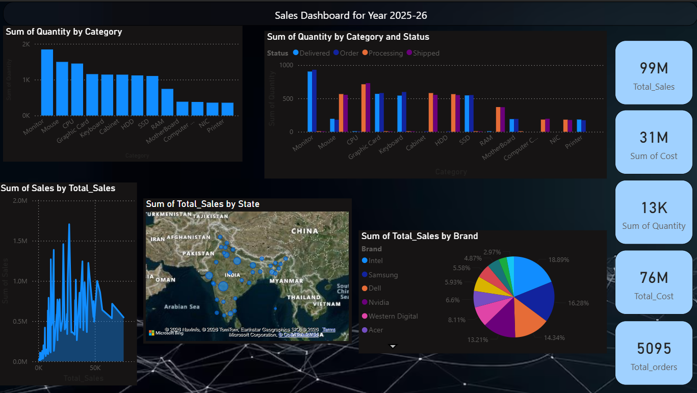

# Techno Sales Data Analytics Dashboard

## Project Overview
An interactive sales analytics dashboard developed using Microsoft Power BI to analyze sales trends, monitor key performance indicators (KPIs), and understand overall business performance.

## Key Features
- Sales performance analysis
- KPI monitoring and visualization
- Sales trend analysis
- Interactive dashboard reports
- Data-driven business insights

## Technologies Used
- Microsoft Power BI
- Data Analytics
- Data Visualization

## Dashboard Preview

## Project Files
- `1st project.pbix` – Power BI dashboard file.
- `Screenshots/` – Dashboard screenshots.

## Objective
To transform sales data into meaningful visual insights that help understand business performance and support informed decision-making.
